<p align="center">
  
</p>

<p align="center">
  <a href="https://www.notion.so/1c9b441d9b8c8085bc4efc7de9fe7471"></a>
  
</p>

<br />

## 👩‍💻 About Me

```ts
const sohee = {
  role: "Full-Stack Developer",
  focus: ["Clean Code", "User Experience"],
  stack: {
    frontend: ["Vue", "TypeScript", "JavaScript"],
    backend: ["Spring", "Java"],
    database: ["MySQL", "MariaDB", "Oracle"],
  },
  motto: "Always learning new technologies and best practices 🌱",
};
```

## 🛠 Tech Stack

<p align="center">
  
  <br />
  
</p>

<p align="center">
  
  
</p>

## 🚀 Portfolio

<p align="center">
  <a href="https://www.notion.so/1c9b441d9b8c8085bc4efc7de9fe7471">
    
  </a>
  <br />
  <sub>프로젝트, 데모, 상세 경험은 위 링크에서 확인할 수 있어요.</sub>
</p>

## 📊 GitHub Stats

<p align="center">
  
  
</p>

<p align="center">
  
</p>
